<div align="center">

# Prism

**เตรียม data สำหรับเล่นสดในที่เดียว: แยกเพลงเป็นแทร็กด้วย AI, คลิกที่ตรงกับมือกลอง, เสียงบอกท่อน และเซ็ตลิสต์สำหรับขึ้นเวที**


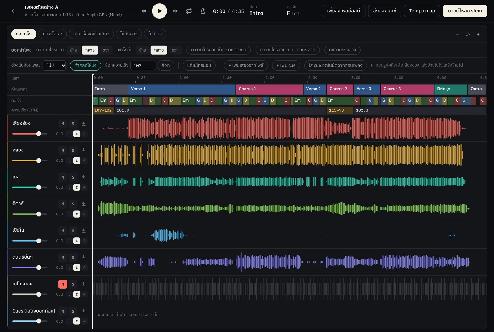

[คู่มือแบบมีภาพ](https://namosarawut.github.io/stem-studio/manual/) · [เริ่มใช้งาน](#เริ่มใช้งาน) · [ฟีเจอร์](#ทำอะไรได้บ้าง) · [ความเป็นส่วนตัว](#ความเป็นส่วนตัว) · [พัฒนาต่อ](#พัฒนาต่อ)

</div>

---

Prism เป็นเว็บแอปที่รันบน Mac ของคุณเอง ทำมาสำหรับนักดนตรีและ MD ที่ต้องเตรียมแทร็กประกอบการแสดงสด (backing data) ใส่ไฟล์เพลงเข้าไป แล้วได้ stem แยกเครื่อง, แทร็กคลิกที่แก้ให้ตรงกับกลองได้ละเอียดถึงมิลลิวินาที, เสียงพูดบอกท่อนในหูฟังวง และเพลย์ลิสต์ที่เล่นต่อกันโดยไม่มีช่องว่าง ส่งออกไปใช้ใน DAW ก็ได้ หรือเล่นจาก Prism บนเวทีเลยก็ได้

ไฟล์เพลงไม่ถูกส่งออกไปไหน ทุกขั้นตอนประมวลผลในเครื่อง หน้าจอทั้งหมดเป็นภาษาไทย

## ทำอะไรได้บ้าง

<table>
<tr>
<td width="50%" valign="top">
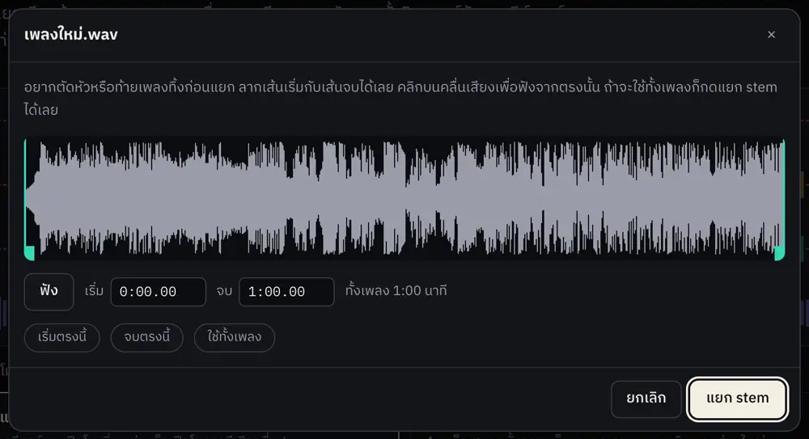<br>
<b>แยกเพลงเป็นแทร็ก</b><br>
ร้อง กลอง เบส กีตาร์ เปียโน และดนตรีอื่นๆ ด้วย Demucs บน GPU ของ Mac เลือกตัดหัวท้ายเพลงก่อนแยกได้ เพลง 4 นาทีบน M3 Pro ใช้เวลาราวครึ่งนาทีถึงหนึ่งนาที
</td>
<td width="50%" valign="top">
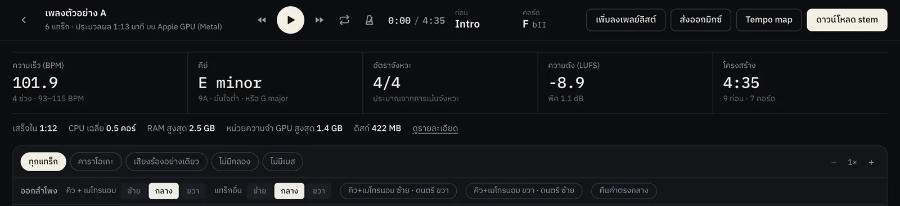<br>
<b>วิเคราะห์เพลงให้ครบ</b><br>
ความเร็ว (รวมเพลงที่ช้าเร็วไม่เท่ากัน), คีย์, คอร์ดทีละจังหวะ, ท่อนเพลง, ลูป และความดัง LUFS
</td>
</tr>
<tr>
<td valign="top">
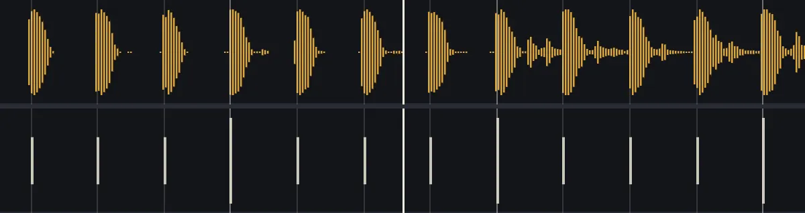<br>
<b>เมโทรนอมที่แก้ได้ทุกบีต</b><br>
ซูมได้ถึง 256 เท่า ลากหรือขยับทีละ 1 ms ตั้ง BPM เฉพาะช่วง และปุ่ม <i>ซ่อมจุดที่เพี้ยน</i> ที่เทียบกับเสียงกลองแล้วแก้บีตเกิน ขาด หรือเบี้ยวให้เอง
</td>
<td valign="top">
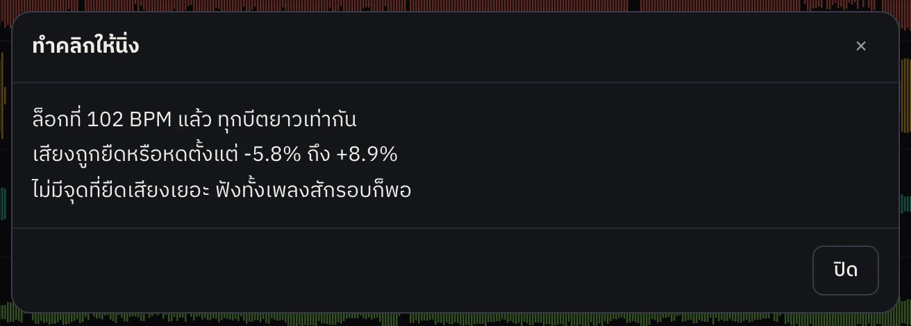<br>
<b>คลิกนิ่งสำหรับเพลงที่อัดโดยไม่มีคลิก</b><br>
<i>ทำคลิกให้นิ่ง</i> ซ่อมเมโทรนอมแล้วยืดหรือหดเสียงทุกแทร็กเท่าๆ กันให้ทุกบีตยาวเท่ากัน ปลดล็อกเมื่อไหร่ก็กลับเป็นเสียงเดิม
</td>
</tr>
<tr>
<td valign="top">
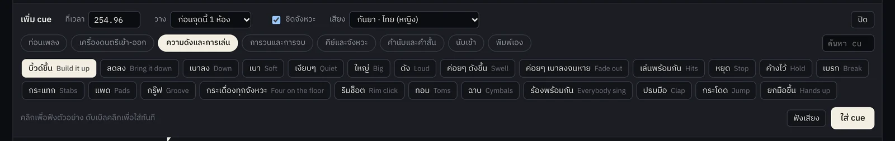<br>
<b>เสียงบอกท่อนและนับเข้า</b><br>
คำพูดไทยและอังกฤษ 135 คำ พิมพ์เองได้ ใส่อัตโนมัติก่อนทุกท่อนได้ในคลิกเดียว นับเข้า 7 แบบที่ย้ายตามเมโทรนอม พร้อมช่วงนับก่อนเพลง
</td>
<td valign="top">
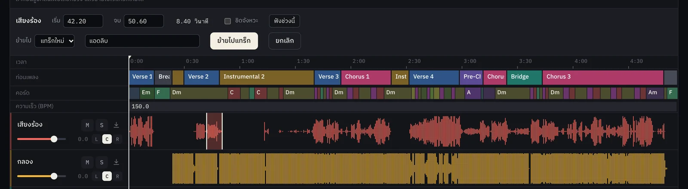<br>
<b>จัดแทร็กเพิ่มเอง</b><br>
ตัดบางช่วง (เช่น แอดลิบ, โซโล่) ไปเป็นแทร็กใหม่ เพิ่ม sample หรือ intro จากไฟล์ ส่งคลิกกับ cue ไปลำโพงซ้าย ดนตรีไปขวา
</td>
</tr>
<tr>
<td valign="top">
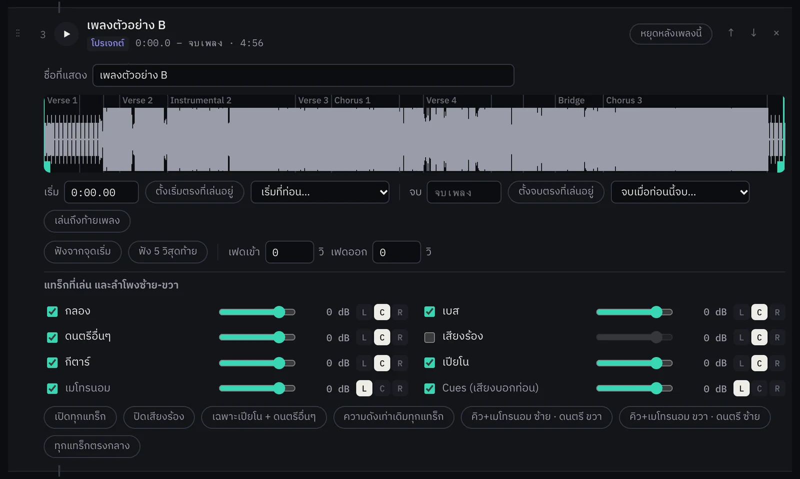<br>
<b>เพลย์ลิสต์ที่เล่นต่อกันไม่มีช่องว่าง</b><br>
ตั้งจุดเริ่มจบจากท่อนเพลง เฟดเข้าออก เลือกแทร็กและความดังของแต่ละเพลง หยุดรอหลังบางเพลง และใส่ไฟล์ที่ไม่ต้องแยกเสียงปนได้
</td>
<td valign="top">
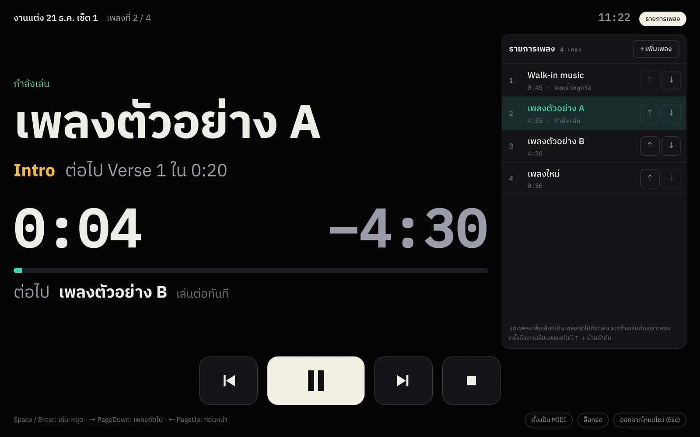<br>
<b>โหมดโชว์สำหรับบนเวที</b><br>
เต็มจอ ตัวหนังสือใหญ่ บอกท่อนที่เล่นอยู่และเวลาที่เหลือ คุมด้วยแป้นเหยียบหรือ MIDI ล็อกจอกันมือโดน และเครื่องไม่หลับระหว่างเล่น
</td>
</tr>
</table>

ส่งออกได้ทั้ง ZIP ของทุกแทร็ก (ยาวเท่ากัน วางที่ 0 ใน DAW แล้วตรงกันทันที), WAV ทีละแทร็ก, มิกซ์ที่ได้ยินอยู่เป็นไฟล์เดียว และ **Tempo map** (`tempo.mid`) ที่ทำให้ grid ของ DAW ตรงกับเพลง

## เริ่มใช้งาน

**สิ่งที่ต้องมี:** Mac ชิป Apple (M1 ขึ้นไป) และ Python 3.10–3.12 (`brew install python@3.12`) ส่วน ffmpeg มากับ dependency แล้ว

```bash
git clone https://github.com/namosarawut/stem-studio.git
cd stem-studio
./start.command
```

หรือดับเบิลคลิก `start.command` ใน Finder ครั้งแรกจะสร้าง `.venv` และติดตั้งของที่ต้องใช้ให้เอง แล้วเปิด http://127.0.0.1:8765 ในเบราว์เซอร์ (เปลี่ยนพอร์ตได้ด้วย `STEM_STUDIO_PORT`) โมเดล AI ราว 1.3 GB ดาวน์โหลดตอนแยกเพลงแรกและเก็บไว้ที่ `models/` หลังจากนั้นใช้งานได้โดยไม่ต้องต่อเน็ต

> [!TIP]
> **คู่มือทุกขั้นตอนพร้อมภาพ:** https://namosarawut.github.io/stem-studio/manual/\
> ตั้งแต่นำเข้าเพลง แก้เมโทรนอม ใส่ cue จนถึงโหมดโชว์ ในแอปเปิดได้จากปุ่ม **คู่มือ** ที่หน้าแรก (ใช้ได้ตอนไม่มีเน็ต) ต้นฉบับอยู่ที่ [docs/manual/](docs/manual/index.html)

<table>
<tr>
<td width="33%" valign="top">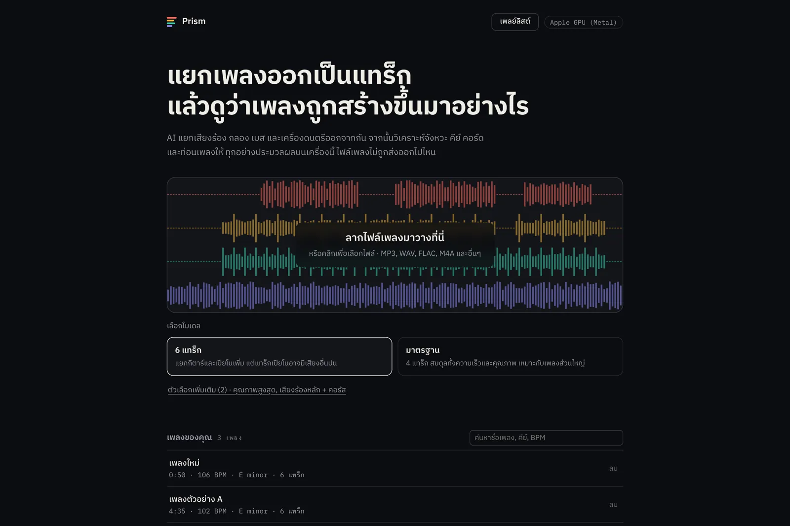<br><b>1.</b> ลากไฟล์เพลงมาวาง เลือกโมเดล</td>
<td width="33%" valign="top">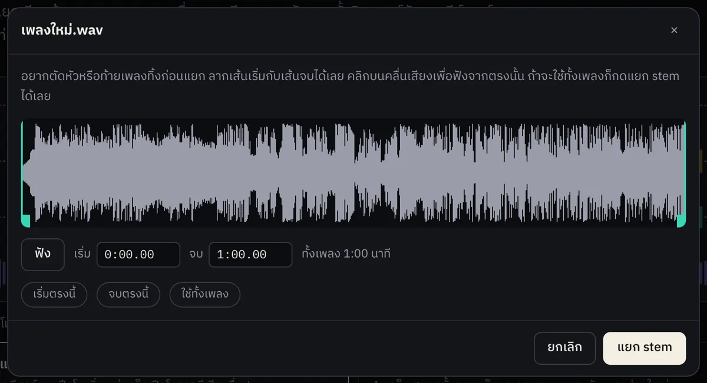<br><b>2.</b> ตัดหัวท้ายถ้าต้องการ แล้วกดแยก stem</td>
<td width="33%" valign="top">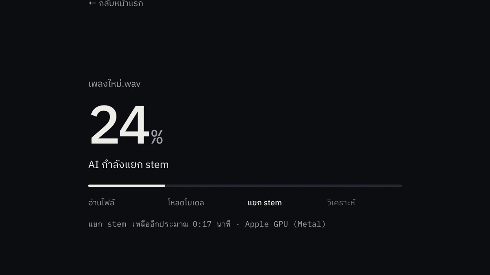<br><b>3.</b> รอแยกเสียงและวิเคราะห์ แล้วหน้าเพลงจะเปิดเอง</td>
</tr>
</table>

### โมเดล

| ในแอป | โมเดล | ได้แทร็ก | หมายเหตุ |
|---|---|---|---|
| 6 แทร็ก | `htdemucs_6s` | ร้อง กลอง เบส กีตาร์ เปียโน อื่นๆ | ค่าเริ่มต้น แทร็กเปียโนอาจมีเสียงอื่นปน |
| มาตรฐาน | `htdemucs` | ร้อง กลอง เบส อื่นๆ | เร็ว |
| คุณภาพสูงสุด | `htdemucs_ft` | ร้อง กลอง เบส อื่นๆ | เสียงสะอาดกว่า ใช้เวลาราว 4 เท่า |
| เสียงร้องหลัก + คอรัส | `htdemucs_lead` | ร้องนำ คอรัส กลอง เบส อื่นๆ | Demucs แล้วแยกเสียงร้องต่อด้วย MelBand Roformer ครั้งแรกโหลดโมเดลเพิ่ม 913 MB |

## ความเป็นส่วนตัว

- เพลง การแก้ไข และเพลย์ลิสต์อยู่ใน `data/` บนเครื่องนี้ เซิร์ฟเวอร์รับเฉพาะการเรียกจากเครื่องเดียวกัน (`127.0.0.1`)
- เสียงพูด cue สร้างด้วยคำสั่ง `say` ของ macOS แบบออฟไลน์
- ฟีเจอร์เดียวที่ส่งข้อมูลออกนอกเครื่องคือปุ่ม **ให้ Claude ช่วยดู** ในแผงแก้เมโทรนอม ซึ่งไม่บังคับใช้และถามยืนยันทุกครั้ง ส่งเฉพาะตัวเลข (เวลาของบีต เวลาที่กลองกับเบสตี และชื่อท่อน) **ไม่ส่งไฟล์เสียงและไม่ส่งชื่อเพลง** ใช้ Claude Code ที่ล็อกอินไว้ (`claude auth login`) หรือ API key จาก console.anthropic.com (เก็บที่ `~/.config/prism/anthropic-key` หรือ `ANTHROPIC_API_KEY`)
- ลบเพลง ไฟล์นำเข้า หรือเพลย์ลิสต์แล้วจะไปอยู่ในถังขยะ 7 วัน กู้คืนได้จากหน้าแรก

## เบื้องหลัง

<details>
<summary><b>วิธีวิเคราะห์เพลง</b></summary>

- **จังหวะ:** ติดตามบีตจากแทร็กกลอง ใช้ hop ที่หารความยาวบีตลงตัวในแต่ละเพลง จับการเปลี่ยนความเร็วทั้งแบบค่อยๆ เปลี่ยนและเปลี่ยนทันที (ท่อน half-time หรือจังหวะขัดไม่ถูกนับเป็นความเร็วใหม่) แล้วขยับบีตให้ตรงหัวเสียง
- **คีย์:** เทียบ chroma กับโปรไฟล์ Krumhansl-Kessler แล้วใช้คอร์ดช่วยตัดสินระหว่างเมเจอร์กับไมเนอร์สัมพันธ์
- **คอร์ด:** เทียบเทมเพลตเมเจอร์/ไมเนอร์ทีละจังหวะจากเบสและเครื่องดนตรี แล้วทำให้ต่อเนื่องด้วย Viterbi
- **ท่อนเพลง:** agglomerative clustering แบบจำกัดให้ท่อนต่อเนื่องในระดับห้อง จัดกลุ่มท่อนที่ซ้ำ และตั้งชื่อจากเสียงร้อง พลังงาน และการซ้ำ
- **ซ่อมเมโทรนอม:** หาจุดที่บีตหลุดจากเสียงกลอง (บีตขาด เกิน หรือถูกลากเบี้ยว และจุดที่การล็อกต้องยืดเสียงเกินไป) แล้วสร้างช่วงนั้นใหม่ระหว่างบีตที่ตรงกลองแน่นอน
- **ล็อกความเร็ว:** time map จากบีต ยืดเสียงทุกแทร็กด้วย WSOLA ตามแผนเดียวกัน ทุกแทร็กจึงยังตรงกัน

</details>

<details>
<summary><b>ข้อมูลบนดิสก์</b></summary>

- `data/jobs/<id>/`: ไฟล์ต้นฉบับ, `stems/` (ไม่ถูกแก้หลังแยก), `analysis.json`, `edits.json` (การแก้ทั้งหมด), ผลการตัด/ล็อก/ช่วงนับ และไฟล์ที่สร้างไว้เล่นในเพลย์ลิสต์
- `data/library/`: ไฟล์ที่นำเข้าสำหรับเพลย์ลิสต์ · `data/playlists/`: เพลย์ลิสต์ · `data/trash/`: ถังขยะ
- `models/`: น้ำหนักโมเดลและเสียง cue ที่สร้างไว้

การแก้ทั้งหมดไม่ทำลายต้นฉบับ ย้อนกลับได้เสมอ

</details>

<details>
<summary><b>ทรัพยากรเครื่อง</b></summary>

หลังแยกเสร็จ หน้าเพลงแสดงเวลา CPU, RAM, หน่วยความจำ GPU, ดิสก์ และการดาวน์โหลด แยกตามขั้นตอน ค่า CPU, RAM และหน่วยความจำ GPU วัดเฉพาะแอปนี้ ส่วน % GPU อ่านจาก `ioreg` เป็นค่าของทั้งเครื่อง

</details>

## ข้อจำกัด

- ใช้ได้จริงบน macOS เท่านั้น (Demucs ใช้ Apple GPU ผ่าน MPS และ cue ใช้คำสั่ง `say`)
- คอร์ดรองรับเฉพาะเมเจอร์และไมเนอร์ ยังไม่แยก 7, sus หรือ dim
- ชื่อท่อนเป็นการคาดเดาจากกฎ อาจไม่ตรงกับที่ผู้แต่งตั้งใจ ควรฟังและแก้ cue ก่อนใช้งานจริง
- เพลงที่ใช้โน้ตชุดเดียวกันอาจแยกเมเจอร์กับไมเนอร์สัมพันธ์ไม่ได้ หน้าเพลงจึงแสดงคีย์ทางเลือกเมื่อความมั่นใจไม่สูง
- แยกเสียงหลัก/คอรัสได้ดีเมื่อคอรัสกระจายซ้ายขวา ถ้าคอรัสอยู่ตรงกลาง เสียงหลักอาจหายบางส่วน
- ควรใช้กับเพลงที่คุณมีสิทธิ์ใช้งาน

## พัฒนาต่อ

Python (FastAPI) กับ JavaScript ล้วน ไม่มีขั้นตอน build แก้ไฟล์ใน `static/` แล้วรีโหลดเบราว์เซอร์ก็เห็นผล ส่วนไฟล์ใน `app/` ต้องรีสตาร์ตเซิร์ฟเวอร์

| เอกสาร | เนื้อหา |
|---|---|
| [CLAUDE.md](CLAUDE.md) | โครงสร้างโค้ด ข้อมูลบนดิสก์ และข้อควรระวังก่อนแก้ (ฉบับสั้น) |
| [docs/CONTEXT.md](docs/CONTEXT.md) | เอกสารส่งต่องานฉบับเต็ม: สถาปัตยกรรม schema API และวิธีทดสอบอย่างปลอดภัย |
| [docs/ROADMAP.md](docs/ROADMAP.md) | สิ่งที่อยากทำต่อ |
| [tools/manual/](tools/manual/README.md) | ต้นฉบับคู่มือและสคริปต์ถ่ายภาพ |

ทดสอบกับ**สำเนา**ข้อมูลเสมอ ไม่ใช่โฟลเดอร์ `data/` จริง:

```bash
STEM_STUDIO_DATA=/path/to/copy/data .venv/bin/python -m uvicorn app.main:app --port 8766
```

### ไลเซนส์

โค้ดใน repo นี้เป็น [MIT](LICENSE) ส่วนไลบรารีและโมเดลที่แอปดาวน์โหลดมาใช้มีเงื่อนไขของตัวเอง ดูรายละเอียดใน [THIRD_PARTY_NOTICES.md](THIRD_PARTY_NOTICES.md) ที่ควรรู้ก่อนใช้ในงานจ้างหรือแจกจ่ายต่อ:

- **เสียง cue** จากคำสั่ง `say` ของ macOS ไลเซนส์ของ Apple อนุญาตเฉพาะการใช้ส่วนตัวที่ไม่ใช่เชิงพาณิชย์
- **โหมดเสียงร้องหลัก + คอรัส** ใช้โมเดลที่ยังไม่พบไลเซนส์ ถือเป็นโหมดทดลอง
- **โมเดล Demucs** โค้ดและน้ำหนักเป็น MIT แต่เทรนด้วยชุดข้อมูลที่ให้ใช้เพื่อการวิจัย
- **ffmpeg** ที่มากับ imageio-ffmpeg เป็นรุ่น GPL ถ้าแพ็กรวมไปแจกต้องทำตาม GPL
